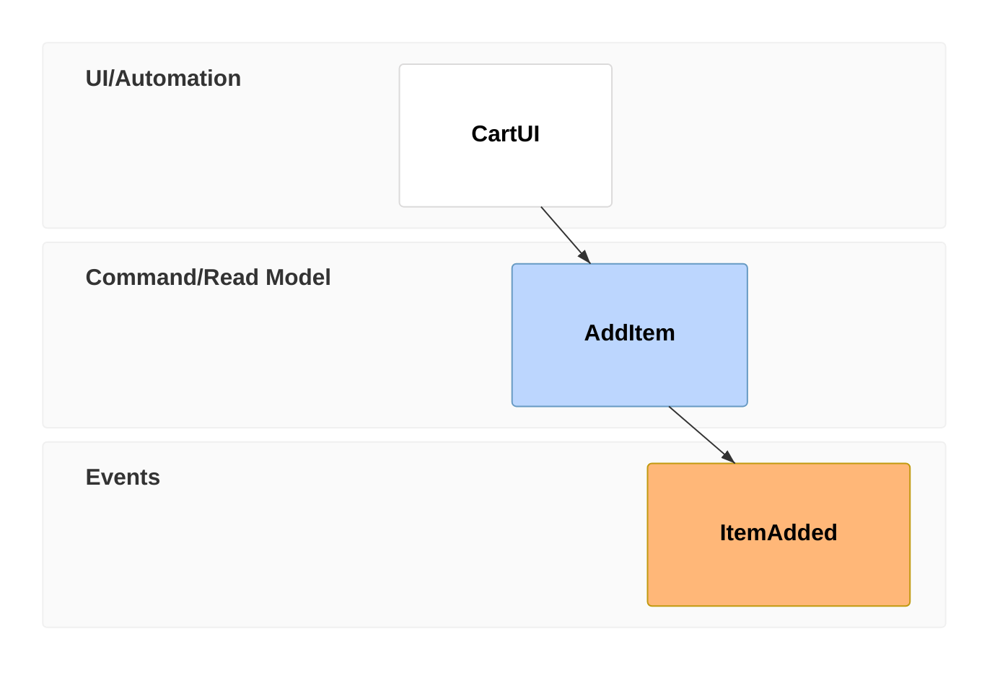
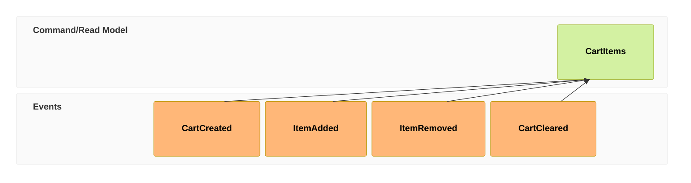
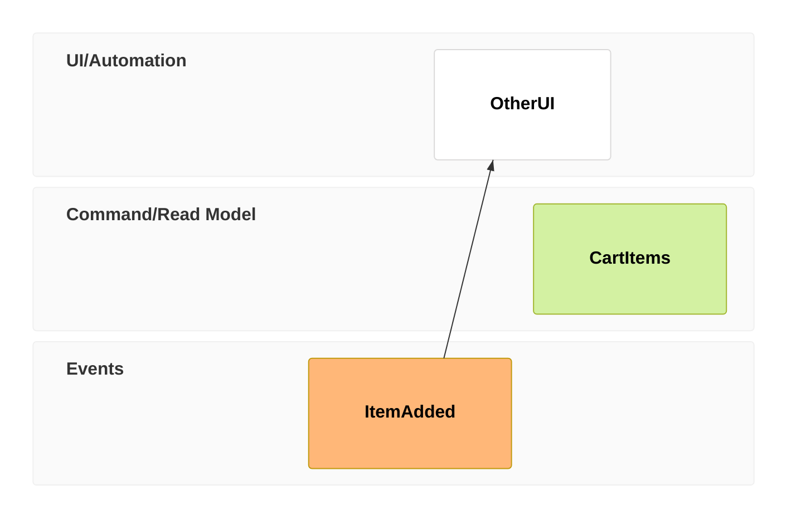
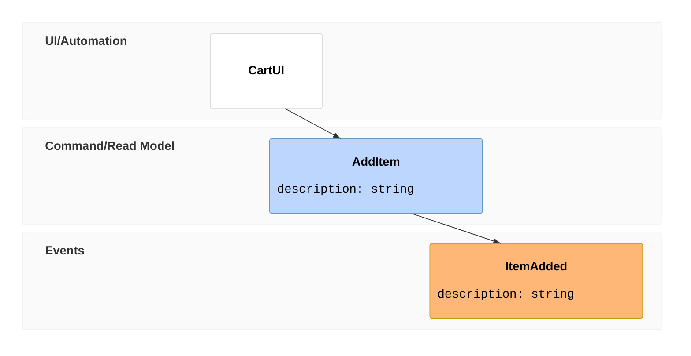
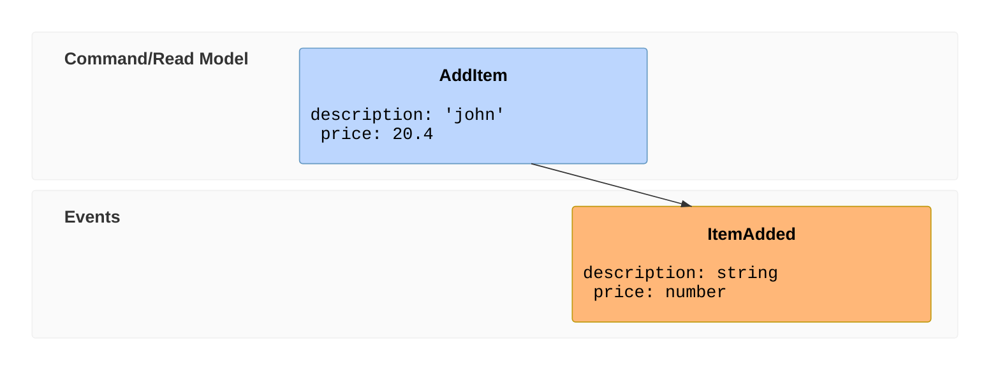
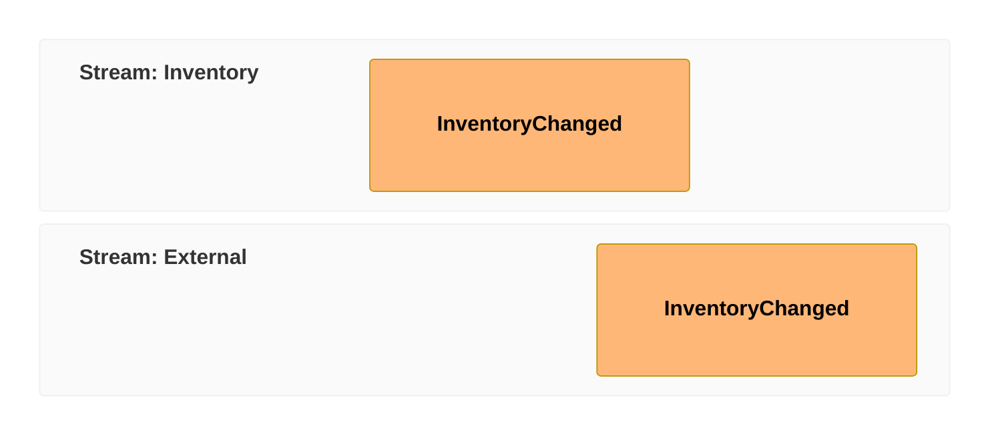

# Event Modeling Reference

Information flow through a system over time — time frames of UI/processor,
command, read-model and event entities, arranged in inferred swimlanes.

## Minimal example

## Syntax

- `eventmodeling` keyword, alone on the first line.
- Time frame (compact): `tf <number> <type> <EntityId>`.
- Time frame (relaxed): `timeframe <number> <type> <EntityId>`.
- Reset frame: `rf <number> <type> <EntityId>` or
  `resetframe <number> <type> <EntityId>`.
- `<number>` — unique identifier for the frame (the parser accepts 1–3
  digits). Declaration order defines the timeline; the numbers themselves need
  not be sequential or in order. Reusing a number for another frame is an
  error.
- `<type>` — entity type (see table below).
- `<EntityId>` — entity identifier; the same identifier may appear in several
  frames to show repeated invocations.
- Explicit relation: append `->> <frame-number>` to a frame; repeat the token
  to connect to several earlier frames.
- Inline data: append `{ key: value ... }` to a time frame.
- Data block: `data <Id> { key: value ... }`, referenced from a frame with
  `[[Id]]`.

## Entity types

| Compact | Relaxed     | Meaning              | Swimlane            |
| ------- | ----------- | -------------------- | ------------------- |
| `ui`    | `ui`        | UI / trigger         | UI/Automation       |
| `pcr`   | `processor` | Processor/automation | UI/Automation       |
| `cmd`   | `command`   | Command              | Command/Read Model  |
| `rmo`   | `readmodel` | Read model / view    | Command/Read Model  |
| `evt`   | `event`     | Event                | Events              |

Compact and relaxed tokens may be mixed in one diagram.

## Relations

By default relations are inferred from timeline order. A reset frame (`rf`)
stops the inferred relation from the preceding frame; `->>` wires a frame to
specific earlier frames.

Explicit `->>` links are type-checked: a command may take input only from a UI
or processor; an event only from a command; a read model only from an event; a
processor only from a read model; a UI only from a read model.

## Data

Inline data on a frame:

Data block referenced with `[[Id]]`:

Both inline data and a data block may be prefixed with a type in backticks,
before the braces: `` `json`{ "name": "foo" } `` for inline data, or
`` data UserAdded01 `json`{ ... } `` for a block. Supported types: `json`,
`jsobj`, `figma`, `salt`, `uri`, `md`, `html`, `text` (the renderer does not
style them differently).

## Namespaces and swimlanes

The part of an `EntityId` before the first `.` is a namespace:
`Inventory.InventoryChanged`. Each namespace + entity type combination becomes
its own swimlane; swimlane order follows declaration order.

## Common patterns

- **State change**: `ui` → `cmd` → `evt`.
- **State view**: one or more `evt` frames → `rmo` → `ui`.
- **Translation**: `evt` → `pcr` → `cmd` → `evt`.

These are frame orders; explicit `->>` links must still follow the type
constraints above.

## Notes
- Every frame needs a unique number, including reset frames, before it is
  referenced with `->>`.
- Use `rf` only where inference would draw a wrong edge; otherwise let the
  timeline infer relations.
- Prefer compact tokens (`tf`, `cmd`, `evt`, …) for brevity.
- Requires Mermaid v11.15.0+.
