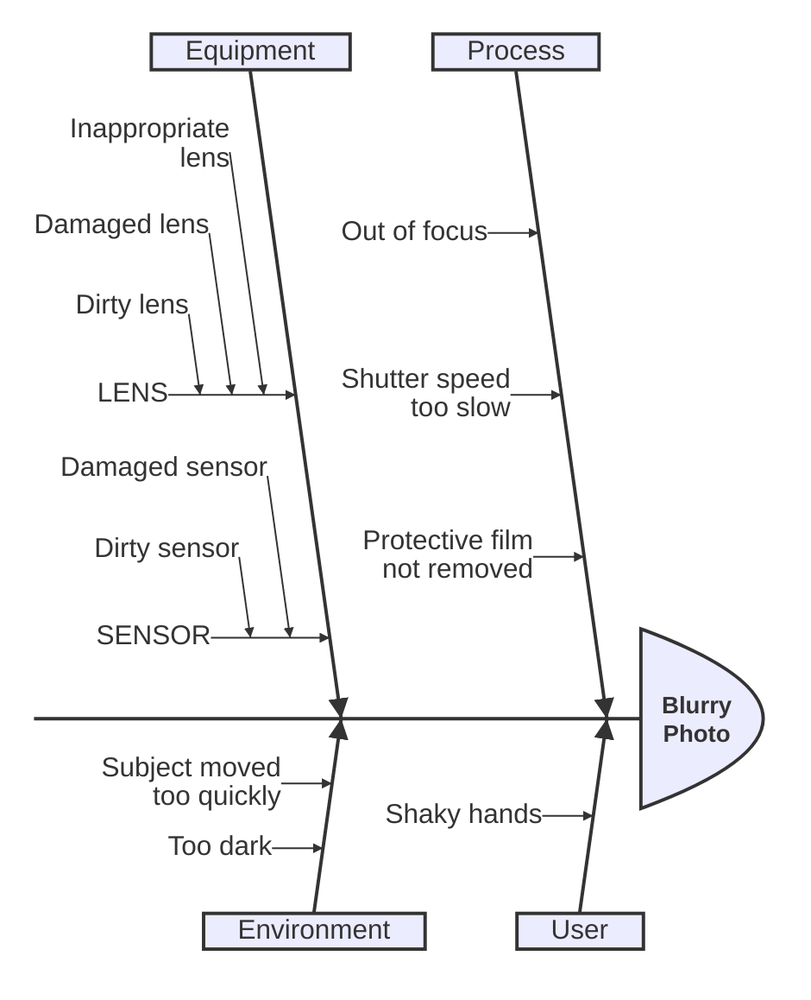

# Ishikawa Reference

Cause-and-effect (fishbone) diagram: one problem at the head, cause categories
branching off a central spine.

## Minimal example

## Syntax

- `ishikawa-beta` keyword (the documented form; bare `ishikawa` is also
  accepted).
- First non-empty line: the event or problem — the fish head.
- Following lines: causes.
- Indentation defines the fishbone structure:
  - the first cause line establishes the base indentation;
  - cause lines at that base level are main cause categories (the bones off
    the spine);
  - deeper indentation nests sub-causes, and further indentation nests further
    levels.
- No arrows, IDs, or edge syntax — structure comes only from line order and
  indentation.

## Notes
- One problem per diagram; put it on the first line.
- Four to six main categories is typical (e.g. Man, Machine, Method, Material,
  Measurement, Environment).
- Use `ishikawa-beta` when many causes are grouped under categories for a
  single problem; use `mindmap` for a neutral topic outline and `flowchart` for
  a causal chain with decisions.
- Keep category labels short; put detail in sub-causes.
- Requires Mermaid v11.12.3+.
