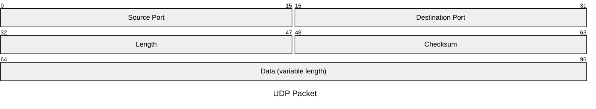
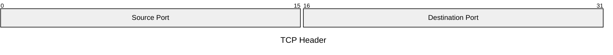

# Packet Reference

Bit-level layout of a binary structure — named fields occupying contiguous bit
ranges, drawn as rows of labeled bit cells (network/protocol headers, hardware
registers, frame formats).

## Minimal example



## Syntax

- `packet` keyword, alone on the first line.
- One field per line:
  - `<start>-<end>: "Label"` — multi-bit field, inclusive bit positions.
  - `<bit>: "Label"` — single-bit field.
  - `+<count>: "Label"` — field of `count` bits starting where the previous
    field ended (no manual offset arithmetic).
- Absolute ranges and `+count` widths can be mixed in one diagram.
- Labels must be double-quoted.
- Bit positions start at 0; list fields in ascending, contiguous order.

## Title

Two equivalent forms:



or frontmatter above the keyword:


## Config

```yaml
---
config:
  packet:
    showBits: true
    bitOrder: descending
    bitsPerRow: 16
---
```

- `showBits` — print bit numbers in each cell (default `true`).
- `bitOrder` — `ascending` (default: lowest bit on the left, suited to network
  packets) or `descending` (highest bit on the left, suited to hardware
  registers). Only the drawing is mirrored: fields are still declared lowest
  bit first (`0-7`, never `7-0`).
- `bitsPerRow` — bits per rendered row (default `32`); longer packets wrap into
  a stack of rows.

## Notes
- Use when the input is a field/bit layout. For boxes and connectors, use
  `block`; for packet processing steps, use `flowchart`.
- Prefer `+<count>` when building a layout from scratch; use absolute ranges
  when reproducing an existing header diagram.
- Keep ranges non-overlapping; a gap or overlap produces misleading output.
- `bitOrder: descending` mirrors each row independently, so a packet wider than
  `bitsPerRow` reads as a stack of words, each running high bit → low bit.
- Requires Mermaid v11.0.0+; `+n` widths need v11.7.0+, `bitOrder` needs
  v12.0.0+.
