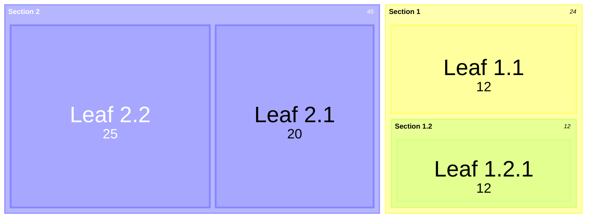
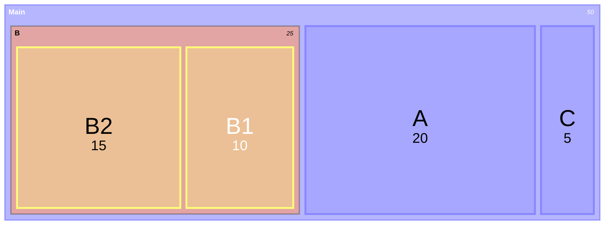

# Treemap Reference

Hierarchical part-to-whole data as nested rectangles; each leaf's area is
proportional to its numeric value.

## Minimal example



## Syntax

- `treemap-beta` keyword (the documented form; bare `treemap` is also
  accepted).
- Section/parent node: `"Section Name"` — quoted, no value.
- Leaf node: `"Leaf Name": <number>` — quoted name, colon, positive numeric
  value.
- Hierarchy is expressed only by indentation (spaces or tabs, consistent within
  the diagram). Top-level sections share the base indentation (normally none);
  children are indented deeper under their parent.
- Optional class: `"Node":::className`, defined with `classDef`.

## Styling



## Config

```yaml
---
config:
  treemap:
    valueFormat: '$0,0'
    diagramPadding: 8
---
```

| Option           | Meaning                                      | Default |
| ---------------- | -------------------------------------------- | ------- |
| `useMaxWidth`    | Scale diagram to 100% of available width     | `true`  |
| `diagramPadding` | Padding around the whole diagram             | `8`     |
| `showValues`     | Show values in the treemap                   | `true`  |
| `valueFormat`    | D3 format string for values                  | `','`   |

Common `valueFormat` patterns: `,` (thousands separator), `$`, `.1f` (one
decimal), `.1%` (percentage), `$0,0`, `$.2f`, `$,.2f`.

## Notes
- Give values to leaves only; a section's area is the sum of its children.
- Leaves cannot have children; indent sub-items under a section, not a leaf.
- Values must be positive — treemaps cannot represent negative values.
- Use `treemap-beta` when the proportions are nested or there are many
  categories; use `pie` for a single flat part-to-whole set.
- Deep hierarchies become hard to label; keep to two or three levels.
- `treemap-beta` is a beta type: the keyword and options may change between
  Mermaid releases.
